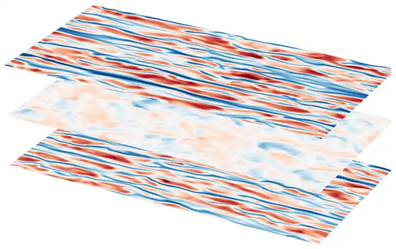
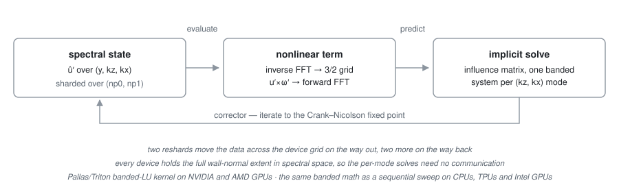
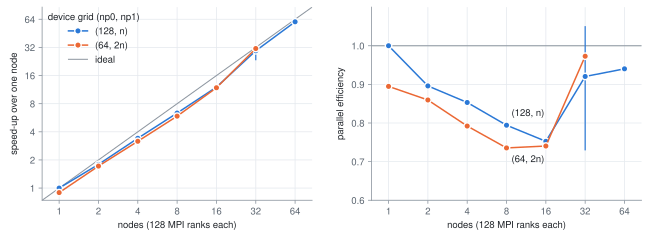

# dnsjax

**A GPU-accelerated pseudo-spectral solver for direct numerical simulation
of the 3D incompressible Navier–Stokes equations, written in
[JAX](https://github.com/jax-ml/jax).**

[](https://github.com/gokhanyalniz/dnsjax/actions/workflows/ci.yml?query=branch%3Amain)


Periodic directions are **pseudo-spectral** (Fourier); up to one
wall-bounded direction uses **banded finite differences**, where an
**influence-matrix method** reconciles incompressibility with the wall
boundary conditions. Five flow systems across four geometries share one
stepping core, and further flows plug in without editing it. The same
code works on **CPUs and GPUs**, and distributes across many.

<a id="fig-planes"></a>
<p align="center">
  
</p>

<p align="center"><em>
Turbulent channel flow at Re<sub>&tau;</sub> &asymp; 180: streamwise
velocity fluctuations on three wall-parallel planes (near each
wall, and at the centreline), over 10 advective time units.<br>
<a href="docs/snapshots.md#fig-streaks">&#128279;&nbsp;See one near-wall
plane by itself.</a>
</em></p>

**Contents** — [Highlights](#highlights) ·
[Quick start](#quick-start) ·
[Flows and geometries](#flows-and-geometries) ·
[Parallelization](#parallelization) ·
[Validation](#validation) ·
[Design decisions](#design-decisions) ·
[What's in the box](#whats-in-the-box) ·
[Documentation](#documentation) ·
[Testing](#testing) ·
[Extending](#extending) ·
[Limitations](#limitations) ·
[References](#references) ·
[The lab](#the-lab) ·
[License and citation](#license-and-citation) ·
[Acknowledgements](#acknowledgements) ·
[Use of AI](#use-of-ai)

## Highlights

- **Runs where JAX runs, tested on CPUs and NVIDIA GPUs** — on one or
  many, double or single precision, all from the same code path;
  wall-normal solves go through a custom Pallas/Triton banded-LU kernel
  on GPUs.
- **Measured from 1 to 64 CPU nodes** — on ARCHER2 (two 64-core AMD
  EPYC 7742 and 256 GB of DDR4-3200 per node), a turbulent channel at
  $1280 \times 383 \times 384$ runs 60 times faster on 64 nodes (8192
  MPI ranks) than on one, at a parallel efficiency of 0.75 to 0.94 on
  every node count from 2 to 64 ([figure](#fig-scaling)).
- **Machine-precision discrete incompressibility, by default** — a
  stepped state's divergence sits at round-off *at any resolution*,
  with less operator storage than in a primitive-variable formulation
  (also available as an option).
- **Five flow systems across four geometries**, all on one stepping
  core; a package of your own adds flows, parameter fields and run-loop
  sections through entry points, without editing the solver — as the
  repository's lab does, with five flows more ([The lab](#the-lab)).
- **Non-modal optimal growth built on the solver itself** — linear
  transient growth about an arbitrary wall-normal profile, reusing the
  solver's own linear step mode by mode.
- **Post-processing that needs no solver** — snapshots are ordinary tar
  archives wrapping a zarr3 store, and the reading API imports nothing
  but NumPy.

## Quick start

```bash
git clone https://github.com/gokhanyalniz/dnsjax.git
cd dnsjax
uv sync
```

The only prerequisite is [`uv`](https://docs.astral.sh/uv/): `uv sync`
fetches the pinned Python (3.14; the floor is 3.12) and every
dependency by itself. The default install pulls a CPU build of JAX; for
**CUDA GPUs** run `uv add "jax[cuda13]"`. An MPI runtime is needed only
to launch several processes, which every multi-CPU run does — not for a
single process that drives all of one node's GPUs, and not for the
post-processing API. Multi-CPU runs should also let MPI carry their
collectives: [`docs/cpu-collectives.md`](docs/cpu-collectives.md).

Output goes to the working directory, so launch from a scratch dir:

```bash
mkdir -p /tmp/run && cd /tmp/run
/path/to/dnsjax/.venv/bin/dnsjax \
  --phys.system pipe --phys.re 2500 --geo.lz 8 \
  --phys.driving constant_bulk_velocity \
  --res.nz 24 --res.nr 32 --res.ntheta 32 \
  --init.localized_rolls True \
  --init.localized_rolls_amplitude 0.3 --init.localized_rolls_width 1.5 \
  --step.dt 0.01 --stop.max_sim_time 200 \
  --outs.it_stats 50
```

Four diameters of pipe at Re = 2500, seeded with a localized roll that
breaks down into turbulence, which in a cell this short is transient
and decays again — a few minutes on one core of a modern CPU. The first
step takes noticeably longer than the rest (JIT compilation);
statistics then stream to `stats.dat`. The same run as a configuration
file is
[`examples/pipe-re2500/parameters.toml`](examples/pipe-re2500/parameters.toml).
[`examples/`](examples/) has three more — plane-Poiseuille,
plane-Couette and Kolmogorov flow (sinusoidally driven flow in a
triply-periodic box) — each small enough to run easily on one core of a
modern laptop.

`dnsjax --help` lists the global parameters and the flows, `--help pipe`
one flow's full surface (replace `pipe` for other flows), and
`--sample-toml pipe` prints an annotated template. For a walkthrough of
more flags, the four start modes (from a snapshot file, a random
perturbation of the laminar flow, localized rolls, and the laminar flow
itself), and the output streams, see
[`docs/running.md`](docs/running.md).

## Flows and geometries

| Flow | Geometry | Laminar base / driving | Defining controls |
|---|---|---|---|
| **Pipe** | cylindrical | $U_z = 1 - r^2$, pressure-driven | `re`, axial length `lz` |
| **Taylor–Couette** | annular | $U_\theta = A_0 r + B_0/r$, wall rotation | `re1`, `re2`, `eta`, `lz` |
| **Plane-Poiseuille** | Cartesian | $U = 1 - y^2$, pressure-driven | `re`, `lx`, `lz`, `tilt_degree` |
| **Plane-Couette** | Cartesian | $U = y$, wall-driven | `re`, `lx`, `lz`, `tilt_degree` |
| **Kolmogorov** | triply-periodic | $U = \sin(2\pi y / L_y)$, sine body force | `re`, `lx`, `lz`, `tilt_degree` |

Each flow exposes only the parameters that apply to it, under the names
natural to its geometry: a pipe takes `--geo.lz`/`--res.nr`/`--res.ntheta`
where a plane channel takes `--geo.lx`/`--res.ny`/`--res.nz`. For the
various conventions involved, see
[Conventions](docs/numerics.md#conventions).

The repository's lab adds five flows on the same geometries — a curved
(toroidal) pipe with a metric of its own, quasi-Keplerian Taylor–Couette
flow, Dean flow (a pressure-driven curved channel), and viscoelastic
pipe and Dean flows carrying the polymer conformation tensor — installed
by the same `uv sync` and run the same way:
[`lab/README.md`](lab/README.md#flows), with their equations in
[`lab/docs/numerics.md`](lab/docs/numerics.md).

## Parallelization

One time step: the spectral state is inverse-transformed onto the
$\tfrac{3}{2}$-oversampled grid (which dealiases the quadratic
nonlinearity), the rotational nonlinear term is formed pointwise, and
the result is transformed back and truncated. Two reshards carry the
data across the device grid each way. By default, a semi-implicit
predictor is then corrected toward the Crank–Nicolson fixed point, each
iteration solving a few small banded systems per Fourier mode. **Every
device holds the full wall-normal extent in spectral space, so those
solves need no communication at all.**

<picture>
  <source media="(prefers-color-scheme: dark)"
          srcset="docs/figures/step-pipeline-dark.svg">
  
</picture>

The two sharded axes are **not** equivalent: the `np1` exchange moves
$3/2$ as many bytes as the `np0` one, and a second grid axis adds an
exchange rather than subdividing the first, so the choice of device grid
is not trivial. [`docs/scaling.md`](docs/scaling.md) has the array layout
per geometry, a symbolic memory model linear in $n_x n_y n_z$ that sizes
a configuration before it is launched, and how to pick the device grid
$(n_{p0}, n_{p1})$ on one node and across many.

The tools behind those numbers — a layout and strong-scaling sweep
driver, a per-rank memory budget from XLA's buffer assignment, a
per-node memory sampler and GPU profiles of the banded solve — are the
lab's: [performance scripts](lab/README.md#scripts).

<a id="fig-scaling"></a>
<picture>
  <source media="(prefers-color-scheme: dark)"
          srcset="docs/figures/archer2-scaling-dark.svg">
  
</picture>

<p align="center"><em>
Strong scaling of a turbulent channel at 1280 &times; 383 &times; 384 on
ARCHER2, from 1 to 64 nodes (128 to 8192 MPI ranks, one per core),
against the fastest one-node run; each point is the mean of all its
runs, two to four, its bar their range. A node: two 64-core AMD
EPYC 7742 (Zen&nbsp;2, 2.25&nbsp;GHz nominal, run at 2.0) with 256 GB of
DDR4-3200 over eight channels per socket, Infinity Fabric within a
socket and three xGMI links between the two, and HPE Slingshot between
nodes, as the site documented them on 7 October 2026.
</em></p>

Every run reproduces the same trajectory to round-off. The efficiency
falls to 0.75 by 16 nodes and rises again, to 0.92 at 32 and 0.94 at 64.
That rise is a per-rank speed-up, not the network's: one node shows it
too when each of its ranks holds the same share of the problem.
[`docs/scaling.md`](docs/scaling.md#strong-scaling-on-archer2) has the
machine, the method, the tables and that breakdown.

## Validation

The optimal-growth module reproduces published values for all four of
its flows to about 2 % or better, and the rest of the suite pins the
discrete divergence, the energy budget, the temporal order, the banded
kernel against a dense reference, and the analysis API against the
solver's own operators. Every claim is mapped to the test that backs it
in [`docs/validation.md`](docs/validation.md). The lab's flows and
tools have a page of their own,
[`lab/docs/validation.md`](lab/docs/validation.md).

## Design decisions

- **Banded finite differences in the wall-normal direction, not
  Chebyshev.** A Chebyshev basis fixes a Chebyshev–Gauss–Lobatto (CGL)
  grid for the wall-normal direction, whereas finite differences leave
  the grid free, which is especially helpful for large-Re studies. CGL
  is still the default, stretched tanh grids are built in, and
  arbitrary grids are also supported.
- **Velocity–vorticity (internally), not primitive variables.**
  Advancing the wall-normal velocity and vorticity and reconstructing
  the tangential pair removes the discrete pressure entirely. Continuity
  is then an algebraic identity, instead of a convergent truncation
  error. User-facing arrays are always velocity components. A
  primitive-variable-based stepping is optionally provided.
- **Influence matrix, not a projection.** One wall condition can only be
  fixed indirectly: the wall pressure in the primitive form, and
  $(D_1 v)|_\text{wall} = 0$ in the velocity–vorticity one. Precomputing
  the homogeneous responses once turns that into a $1\times1$ or
  $2\times2$ per-mode solve. Tangential no-slip is then exact as a
  consequence rather than a separately imposed condition — which is why
  the wall values of $u$ and $w$ double as a live diagnostic that the
  influence matrix is healthy. A fractional-step projection avoids all of
  it at the cost of a splitting error no resolution removes.
- **Two sharded axes, deliberately asymmetric.** The linear wall-normal
  solves stay simple and communication-free only while the wall-normal
  data are device-local. The device mesh is built around that first;
  keeping data transposes to a minimum comes second.
- **Tests as standalone scripts.** Configuration lives in module-level
  singletons captured at import, and JAX's platform and precision are
  process-wide, so a test has to own its process: each runs as its own
  script, and `pytest` collects them through a subprocess bridge.
- **JAX rather than hand-written CUDA or Fortran.** One source targets
  CPU, GPU and TPU and shards across devices without a second
  implementation. Where standard JAX is not enough, such as for the
  wall-normal banded sweep, a Pallas kernel is used under the same API.

## What's in the box

| | |
|---|---|
| **Banded-LU GPU kernel** | $O(N_y p)$ factors instead of dense $O(N_y^2)$, with a dense reference solver; checked in interpret mode *and* by lowering to CUDA on GPU-less machines |
| **Differentiable time steps** | `jax.grad` through a step, opt-in: a fixed-count corrector replaces the one construct reverse mode cannot traverse, and the banded GPU kernel carries a custom adjoint — [docs/differentiability.md](docs/differentiability.md) |
| **Optimal-growth analysis** | linear optimal energy growth $G(t)$ about an arbitrary wall-normal profile, reusing the solver's own linear step per mode — [docs/validation.md](docs/validation.md#non-modal-optimal-growth-against-published-values) |
| **Two-axis device mesh** | $(n_{p0}, n_{p1})$ with an in-FFT reshard pipeline — [docs/scaling.md](docs/scaling.md#parallelization) |
| **A memory–throughput dial** | `solver.rhs_transform_chunks` splits the batched inverse transform $k$ ways, cutting its working set $k$-fold at identical results |
| **Snapshots and resume** | tar + zarr3, written by every device in parallel; resume across any device count, re-gridding every changed axis — [docs/snapshots.md](docs/snapshots.md) |
| **Reduced-resolution snapshots** | on a cadence of their own: Fourier axes truncated, the wall-normal axis interpolated, every field computed at full resolution first, optionally with the static pressure on the plane channels — [docs/running.md](docs/running.md#reduced-resolution-snapshots) |
| **External-data import** | pack a field produced elsewhere into a valid snapshot — [docs/snapshots.md](docs/snapshots.md#importing-a-field-from-elsewhere) |
| **Initial conditions** | divergence-free random fields and deterministic localized spots, reproducible independent of device count |
| **Adaptive CFL stepping** | re-selects $\Delta t$ and rebuilds the implicit operators on device with no recompilation |
| **Moving frame** | integrate in a translating frame, implicitly in both time schemes |
| **Crash-consistent diagnostics** | buffered streams flushed before snapshots and on termination; a NaN or inf aborts naming the quantity and writes no snapshot of the broken state |
| **Graceful shutdown** | an ISO 8601 wall-time budget ends the run cleanly, final snapshot included, before a queue kills it |
| **Laminarization auto-stop** | a run ends once the perturbation energy falls below a threshold |
| **In the lab** | lockstep twin runs streaming a perturbation's growth, budget and spectra; `[probes]` and `[force]` run-loop streams; a response analysis from a turbulent run to a linear operator — [The lab](#the-lab) |

## Documentation

| file | what it covers |
|---|---|
| [`docs/numerics.md`](docs/numerics.md) | equations, discretization, wall-normal grids, the influence-matrix method, per-flow conventions |
| [`docs/scaling.md`](docs/scaling.md) | array layout, the memory model, choosing the device grid, measured strong scaling |
| [`docs/running.md`](docs/running.md) | a worked run, start modes, seeds, the moving frame, every output stream |
| [`docs/configuration.md`](docs/configuration.md) | how the parameter layers combine; extension sections |
| [`docs/snapshots.md`](docs/snapshots.md) | the snapshot format, resume and re-gridding, the JAX-free API, the importer |
| [`docs/validation.md`](docs/validation.md) | what is checked against what, and which test pins each claim |
| [`docs/differentiability.md`](docs/differentiability.md) | what differentiates through a step, the two opt-in knobs, the banded solve's adjoint |
| [`docs/extending.md`](docs/extending.md) | adding a flow system, in this package or from your own |
| [`docs/cpu-collectives.md`](docs/cpu-collectives.md) | routing multi-process CPU collectives through MPI |
| [`tests/README.md`](tests/README.md) | how the suite is laid out and how to run it |
| [`scripts/README.md`](scripts/README.md) | the offline tools: figures, a snapshot perturbation, wall-normal resolution |
| [`CONTRIBUTING.md`](CONTRIBUTING.md) | setup, lint, tests, adding a flow, commit style, releases |
| [`lab/README.md`](lab/README.md) | the lab: its flows, runs and analyses, scripts and tests |
| [`lab/docs/numerics.md`](lab/docs/numerics.md) | the lab flows' equations and conventions |
| [`lab/docs/validation.md`](lab/docs/validation.md) | what the lab's flows and tools are checked against |

Field-by-field parameter documentation lives in the code, rendered per
flow by `dnsjax --help <system>` and `dnsjax --sample-toml <system>`.

## Testing

41 standalone scripts under `tests/`, run directly
(`uv run python tests/test_cartesian.py`) or through a pytest bridge that
shells each one out as a subprocess. They pin the solvers and operators
against independent constructions; the physics (laminar fixed points at
machine precision, the full nonlinear path for every distinct stepping
machinery, second-order temporal convergence, energy-budget closure); the
machinery (snapshot round-trips, device-count-agnostic resume, the
JAX-free import guarantee); and the published optimal-growth values.
Several launch real `mpirun` multi-device runs; none needs a GPU. See
[`tests/README.md`](tests/README.md). The lab's suite adds 36 scripts of
its own, collected by the same `pytest`
([`lab/README.md`](lab/README.md#tests)).

## Extending

Adding a flow system on an existing geometry is a two-file operation: a
**`FlowSpec`** and the flow module it names — in this package, under
`src/dnsjax/flows/<family>/specs/`, or in a package of your own that
registers its specs through the `dnsjax.flows` entry point. Nothing
else is edited — the `phys.system` literal, the `--help` and
`parameters.toml` surfaces, `--sample-toml`, the snapshot metadata
surface, the stepping dispatch and the analysis package's geometry sets
all derive from the registry and extend themselves. A flow with a
metric of its own adds a geometry module as well, and parameter fields
and run-loop sections plug in the same way. See
[`docs/extending.md`](docs/extending.md). The lab is the worked example
of every extension point: five flows, one with a metric of its own,
parameter fields and two run-loop sections
([`lab/README.md`](lab/README.md)).

## Limitations

- **Tested on CPUs and NVIDIA GPUs.** The code paths are
  backend-agnostic and the solver accepts `cuda`, `rocm` and `tpu`
  alike, but only CPU and CUDA are exercised regularly; AMD (ROCm) has
  had minimal testing and TPUs none at all. The banded kernel's adjoint
  has its numerics checked in interpret mode and is lowered for CUDA,
  but **reverse mode through it has not yet been run on a GPU**.
- **One wall-bounded direction.** The discretization admits at most one
  non-periodic direction.
- **Perturbing the mean profile is Cartesian-only.** The
  $(k_x, k_z) = (0, 0)$ mode may be perturbed only for the two plane
  channels, whose mean-mode conservation laws are established; every
  other flow declares the field and refuses it with its own message
  rather than appearing to offer something it does not implement.
- **Resume requires matching precision.** Device count, resolution and
  grid all re-grid on load; a single/double mismatch is rejected.
- **CPU collectives over MPI are untested on macOS**, where the library
  search cannot fire — [docs/cpu-collectives.md](docs/cpu-collectives.md).

## References

The numerics follow these references:

- A. P. Willis, *The Openpipeflow Navier–Stokes solver*, SoftwareX **6**,
  124–127 (2017). Predictor–corrector time stepping and the decoupled
  $u_\pm$ pipe/annular formulation.
- S. A. Orszag, *On the elimination of aliasing in finite-difference
  schemes by filtering high-wavenumber components*, J. Atmos. Sci.
  **28**(6), 1074 (1971). The 3/2 dealiasing rule.
- C. Canuto, M. Y. Hussaini, A. Quarteroni and T. A. Zang, *Spectral
  Methods in Fluid Dynamics*, Springer (1988). Pseudo-spectral methods,
  and the continuity argument behind the influence-matrix method.
- L. Kleiser and U. Schumann, *Treatment of incompressibility and boundary
  conditions in 3-D numerical spectral simulations of plane channel flows*,
  in *Proc. 3rd GAMM Conference on Numerical Methods in Fluid Mechanics*,
  165–173, Vieweg (1980). The influence-matrix method.
- J. Kim, P. Moin and R. Moser, *Turbulence statistics in fully developed
  channel flow at low Reynolds number*, J. Fluid Mech. **177**, 133–166
  (1987). The wall-normal velocity–vorticity formulation.
- L. S. Tuckerman, *Divergence-free velocity fields in nonperiodic
  geometries*, J. Comput. Phys. **80**, 403–441 (1989). The influence
  matrix for the split fourth-order wall-normal velocity equation.
- P. Luchini and M. Quadrio, *A low-cost parallel implementation of direct
  numerical simulation of wall turbulence*, J. Comput. Phys. **211**,
  551–571 (2006). Wall-normal finite differences in a velocity–vorticity
  solver.
- B. Fornberg, *Calculation of weights in finite difference formulas*, SIAM
  Review **40**(3), 685–691 (1998). Finite-difference weights on non-uniform
  grids.
- L. N. Trefethen, *Spectral Methods in MATLAB*, SIAM (2000). Clenshaw–Curtis
  quadrature and spectral differentiation.
- J. A. C. Weideman and S. C. Reddy, *A MATLAB differentiation matrix suite*,
  ACM Trans. Math. Softw. **26**(4), 465–519 (2000). Differentiation and
  interpolation matrices.

## The lab

This repository also holds [`lab/`](lab/README.md), a second package
developed alongside the solver and never released with it. It plugs
into the solver through the same entry points a package of your own
would use, and `uv sync` installs both into one environment. What it
adds:

- **Five flows** on the solver's geometries — the curved pipe,
  quasi-Keplerian Taylor–Couette, Dean, and the viscoelastic pipe and
  Dean — [`lab/README.md`](lab/README.md#flows), their equations in
  [`lab/docs/numerics.md`](lab/docs/numerics.md) and their checks in
  [`lab/docs/validation.md`](lab/docs/validation.md).
- **Twin runs**: `dnsjax-twin` steps a reference snapshot and a
  perturbed copy in lockstep and streams the difference field's
  energies, budget and spectra —
  [`twin/`](lab/src/dnsjax_lab/twin/README.md).
- **Runtime streams**: `[probes]` records the wall-normal profiles of
  chosen spectral modes, `[force]` drives them with white-in-time kicks
  — [`extensions/`](lab/src/dnsjax_lab/extensions/README.md).
- **Response analysis**: from a turbulent run to a data-driven linear
  operator, three interchangeable ways —
  [`analysis/response/`](lab/src/dnsjax_lab/analysis/response/README.md).
- **Scripts**: ensembles and twin post-processing; the performance
  tools (benchmarks, profiles, memory sizing, the scaling figure);
  functionality checks (differentiability, GPU kernel and storage
  diagnostics); a refactor regression check, the release tooling and the
  documentation checkers — [`lab/README.md`](lab/README.md#scripts).
- **Tests**: 36 scripts of its own, collected by the same `pytest` —
  [`lab/README.md`](lab/README.md#tests).

Its own limitations: [`lab/README.md`](lab/README.md#limitations).

## License and citation

Released under the [Apache License 2.0](LICENSE), © 2025–2026 Gökhan Yalnız.
If `dnsjax` supports your work, a citation of this repository
(<https://github.com/gokhanyalniz/dnsjax>) is appreciated.

## Acknowledgements

I developed most of `dnsjax` (everything before 1 August 2026) during
my year as a postdoctoral researcher in Björn Hof's group at the
Institute of Science and Technology Austria, and I am grateful for that
opportunity and for the time it gave me to work on this. Substantial
changes have followed, and continue, since I joined Yongyun Hwang's
group at Imperial College London. I also thank Ashley P. Willis for
[`openpipeflow`](https://openpipeflow.org), from which I learned a great
deal. None of them was involved in the development of this code. Any
errors are my own.

## Use of AI

The first version of this solver — the triply-periodic geometry, the
predictor–corrector stepper, and the Kolmogorov flow — was designed and
written by hand. The extension to the wall-bounded geometries grew out of
that core with extensive use of LLM coding assistants.

None of the mathematics here is new: the predictor–corrector stepping,
the influence-matrix treatment of the wall conditions, the Fornberg
finite-difference weights, the 3/2 dealiasing rule and the rest are long
established. What is mine is the selection and the assembly — which
formulation to use where, and how the pieces have to fit together to
make one solver rather than a collection of methods — together with the
strategy for deciding whether the result is right: a dense reference
solver to check the fast path against, per-geometry operators checked
against independent constructions, and published values to land on.
Every assisted change was planned, reviewed and iterated on against
that.
